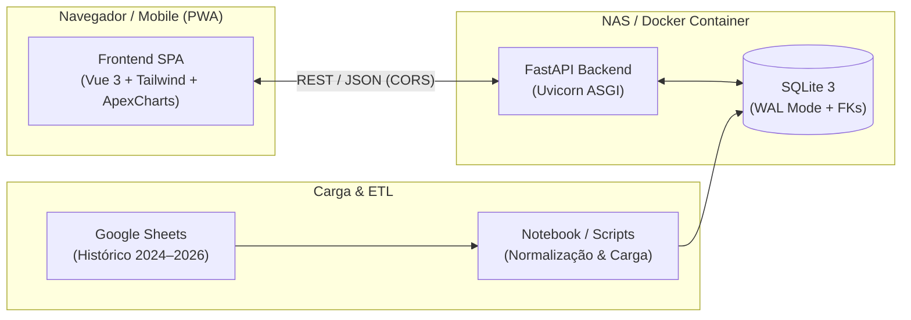
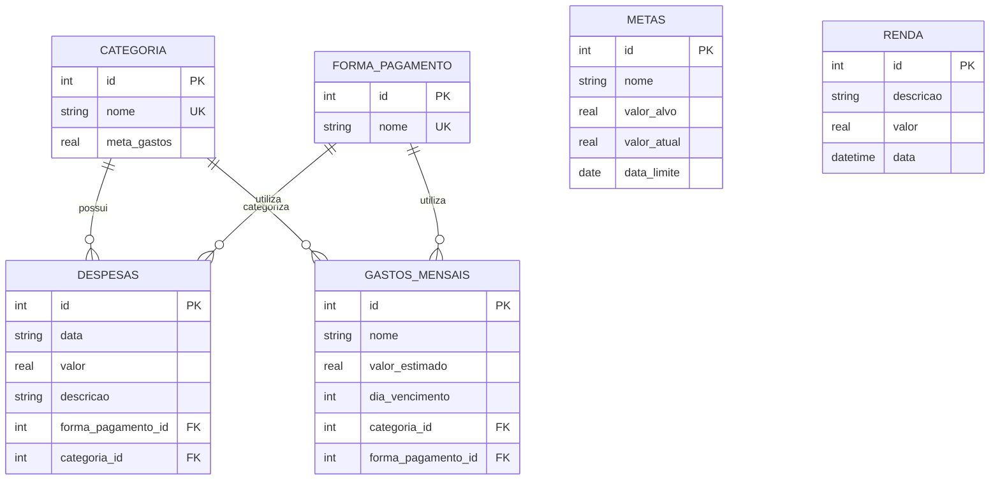

# 💰 Despesas Pessoais — Self-Hosted Finance App

Aplicação web moderna, rápida e de baixo consumo de recursos para **gestão de finanças e despesas pessoais**, projetada para ser conteinerizada (**Docker**) e executada 24/7 em um servidor **NAS doméstico** ou mini PC local.

---

## 🎯 Objeto e Propósito do Projeto

O objetivo principal deste projeto é consolidar o controle financeiro pessoal em uma solução **auto-hospedada (self-hosted)**, oferecendo:

* **Privacidade Total:** Os dados financeiros ficam armazenados exclusivamente no seu hardware (banco SQLite local), sem depender de serviços de terceiros na nuvem.
* **Substituição de Planilhas:** Evolução de planilhas manuais (Google Sheets) para uma aplicação web com validação de dados, integridade referencial e visualizações gráficas.
* **Agilidade no Acesso:** Interface leve e responsiva para lançamento rápido de despesas tanto no computador quanto no celular (via rede local ou VPN segura como Tailscale).
* **Consumo Mínimo no NAS:** Arquitetura otimizada para operar consumindo menos de 60 MB de memória RAM.

---

## 🏗️ Arquitetura da Solução



### 1. Backend (`scripts/backend/`)
* **FastAPI:** Framework web moderno de alta performance baseado em tipos Python (`Pydantic`).
* **Uvicorn:** Servidor ASGI assíncrono leve.
* **SQLite Normalizado:** Banco relacional configurado em modo **WAL (`Write-Ahead Logging`)** para suporte a concorrência sem travamentos de escrita e chaves estrangeiras ativas (`PRAGMA foreign_keys = ON;`).
* **Estrutura Modular:** Rotas divididas em `APIRouter` (`routers/despesas.py`) e schemas padronizados (`schemas.py`).

### 2. Frontend (`scripts/frontend/`)
* **Vue 3 (Composition API):** Reatividade nativa via CDN/ESM, dispensando a necessidade de Node.js/npm no ambiente de execução.
* **Tailwind CSS:** Design moderno em tema escuro (*Dark Mode*), com visual inspirado em componentes do PrimeVue.
* **ApexCharts:** Gráficos interativos de evolução temporal de despesas e distribuição percentual por categoria (*Donut*).
* **Visão Única com Abas:**
  * **Dashboard:** Indicadores-chave (KPIs) de gastos, aportes, média diária e gráficos.
  * **Extrato:** Tabela interativa com busca em tempo real e exclusão com confirmação.
  * **Metas & Orçamento:** Acompanhamento do teto orçado por categoria com barras de progresso.
  * **Nova Despesa:** Modal rápido para registro imediato com data, valor, categoria e pagamento.

### 3. Pipeline de Dados Históricos (`scripts/Extraction/`)
* Extração automatizada de planilhas anuais do Google Sheets via Pandas.
* Normalização de nomes de categorias e formas de pagamento.
* Ingestão direta e limpa no banco SQLite preservando caracteres acentuados em UTF-8 nativo.

---

## 🗄️ Modelagem do Banco de Dados

O banco de dados SQLite (`database/despesas-pessoais`) possui uma modelagem relacional normalizada:



---

## 🚀 Como Executar o Projeto Localmente

### 1. Pré-requisitos
* Python 3.11+ instalado (recomendado 3.13)
* Navegador moderno (Chrome, Edge, Firefox ou Safari)

### 2. Ativar o Ambiente Virtual e Dependências
No terminal (PowerShell no Windows):
```powershell
# Ativar o ambiente virtual existente
.\env\Scripts\Activate.ps1

# Se necessário, instalar as dependências
pip install -r requirements.txt
```

### 3. Iniciar a API (Backend)
```powershell
uvicorn scripts.backend.main:app --reload --port 8000
```
* **API Swagger interativa:** Acesse [http://localhost:8000/docs](http://localhost:8000/docs)
* **Verificação de status:** [http://localhost:8000/](http://localhost:8000/)

### 4. Abrir o Frontend
Você pode abrir o arquivo diretamente no navegador:
* Dê um duplo clique no arquivo [`scripts/frontend/index.html`](scripts/frontend/index.html) no Windows Explorer, **OU**
* Suba um servidor local estático em outro terminal:
```powershell
python -m http.server 3000 --directory scripts/frontend
```
E acesse [http://localhost:3000](http://localhost:3000).

---

## 🗺️ Roteiro de Próximos Passos (Deploy no NAS)

- [x] Extração e carga dos dados históricos (1.100+ registros migrados).
- [x] Correção de encoding UTF-8 no SQLite.
- [x] Estruturação da API FastAPI com rotas de CRUD e filtros.
- [x] Frontend inicial com abas, dashboard, ApexCharts e modal de inserção.
- [ ] Criação do `Dockerfile` multi-stage (imagem enxuta em Python Slim).
- [ ] Criação do `docker-compose.yml` com mapeamento de volume persistente (`./database:/app/database`).
- [ ] Script de backup diário automatizado do arquivo `.db` para outra pasta do NAS.
- [ ] Configuração de acesso externo seguro via Tailscale / Cloudflare Tunnel.

---

## 📄 Licença
Uso pessoal e privado.
